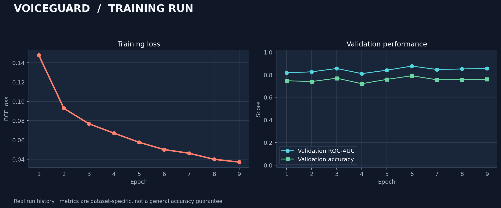
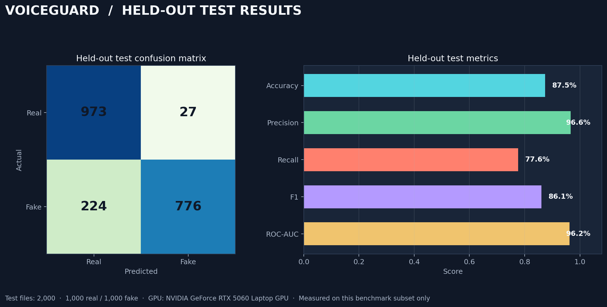

<div align="center">

# VoiceGuard

### Voice Deepfake Detection

**Local-first audio screening with time-window scores and transparent, benchmark-specific results.**

[](https://python.org)
[](https://pytorch.org)
[](https://huggingface.co/docs/transformers)
[](https://streamlit.io)
[](#validation)

[Overview](#overview) · [Architecture](#architecture) · [Benchmark](#benchmark) · [Get started](#get-started) · [Reproduce](#training-and-reproducibility) · [Limitations](#limitations)

</div>

---

## Overview

**VoiceGuard — Voice Deepfake Detector** is a research prototype for screening
speech recordings for signs associated with synthetic or manipulated audio.
Upload a WAV, FLAC, or OGG file in the Streamlit app, or analyze it from the
command line. VoiceGuard returns a `Real` or `Fake` screening decision, a
mean model score, a validation-selected threshold, and scores for audio
windows so the user can review where the model found stronger evidence.

> **Measured result:** The latest recorded experiment achieved **87.45%
> accuracy** and **96.21% ROC-AUC** on a balanced, 2,000-clip held-out subset
> of ASVspoof 2021 DF. This is a result on that benchmark subset—not a
> general-purpose accuracy guarantee or forensic determination.

### Example screening result

The interface shows the prediction, score, threshold, explanation, and
time-localized model evidence.

<div align="center">

</div>

## What it does

- **Audio input:** accepts WAV, FLAC, and OGG speech recordings.
- **Local screening:** decodes and analyzes audio on the machine running the
  app; the app does not upload recordings to a hosted inference service.
- **Time-localized scores:** splits audio into overlapping windows and reports
  each window's score and time range.
- **Explainable output:** shows the overall score, threshold, flagged windows,
  and a concise explanation of the decision.
- **Two model paths:** includes a log-mel CNN and a Wav2Vec2 transfer model.
  The benchmark results below are from the Wav2Vec2 path.
- **Reproducible records:** saves training history, split hashes, run
  configuration, evaluation metrics, and generated evidence.

## Architecture

```text
WAV / FLAC / OGG
        │
        ▼
Decode · mono · resample to 16 kHz
        │
        ▼
Overlapping audio windows (up to 4 seconds)
        │
        ├── Wav2Vec2 encoder
        │       → masked temporal mean + standard-deviation pooling
        │       → binary classification head
        │
        └── Alternate path: log-mel spectrogram → CNN
        │
        ▼
Per-window fake scores → mean score vs. validation-selected threshold
        │
        ▼
Real / Fake screening · score · explanation · flagged time ranges
```

The reported experiment fine-tuned the top four layers of a pretrained
Wav2Vec2 encoder and a binary classification head. The interface displays
model scores and temporal regions; it does not identify a specific synthesis
algorithm or prove that a segment was edited.

### Repository map

```text
app.py                  Streamlit audio-upload and results UI
detect.py               Command-line inference
download_dataset.py     Dataset sampling and provenance manifest
train_transfer.py       Transfer-learning head training
fine_tune_transfer.py   Wav2Vec2 fine-tuning and held-out evaluation
generate_evidence.py   Evidence plots, example detections, and ZIP bundle
show_results.py         Training and evaluation summaries
voiceguard/
  audio.py              Decoding, resampling, and windowing
  transfer.py           Wav2Vec2 model and waveform preparation
  network.py            CNN model and checkpoint loading
  training.py           CNN training utilities
  inference.py          Scoring, thresholds, regions, and explanations
tests/                  Unit and component tests
proofs/                 Training, evaluation, terminal, and UI proofs
```

## Benchmark

The latest run used the NVIDIA GeForce RTX 5060 Laptop GPU and stopped after
nine epochs. The best checkpoint by validation ROC-AUC was selected at epoch
6; the decision threshold was selected on validation data. The held-out test
set was not used for checkpoint or threshold selection.

| Evaluation | Measured result |
|---|---:|
| Training set | 50,000 clips — 25,000 real, 25,000 fake |
| Validation set | 4,000 clips — 2,000 real, 2,000 fake |
| Held-out test set | 2,000 clips — 1,000 real, 1,000 fake |
| Accuracy | **87.45%** |
| ROC-AUC | **96.21%** |
| Precision | **96.64%** |
| Fake recall | **77.60%** |
| F1 score | **86.08%** |
| Validation-selected threshold | 0.9943 |
| Confusion matrix | `[[973, 27], [224, 776]]` |

Confusion-matrix rows are actual labels and columns are predicted labels in
`Real, Fake` order: **973** real clips were correctly classified, **27** real
clips were classified as fake, **224** fake clips were classified as real,
and **776** fake clips were correctly classified.

The new test audio has zero exact-hash overlap with the earlier evaluated
sample. Both samples nevertheless come from the same official ASVspoof 2021
DF test partition and class-ordered source shards; this does not constitute
an independent external benchmark.

### Evaluation and training evidence

| Training / validation curves | Held-out evaluation |
|---|---|
|  |  |

Additional [real and fake detection charts](proofs/),
[captured terminal output](proofs/), and example UI results are in `proofs/`.
The machine-readable metrics and detailed provenance are generated in the
local run directory; trained weights, datasets, and run directories are
intentionally excluded from this repository.

## Technology

| Area | Technology |
|---|---|
| Language | Python 3.10 |
| Deep learning | PyTorch 2.11, Hugging Face Transformers |
| Audio / numerical | SoundFile, SciPy, NumPy |
| Evaluation | scikit-learn |
| Interface | Streamlit |
| GPU used in reported run | NVIDIA GeForce RTX 5060 Laptop GPU, CUDA 12.8 |
| Tests | pytest |

## Get started

### 1. Set up Python and dependencies

In Windows PowerShell:

```powershell
py -3.10 -m venv .venv
.\.venv\Scripts\Activate.ps1
python -m pip install --upgrade pip
python -m pip install torch --index-url https://download.pytorch.org/whl/cu128
python -m pip install -r requirements.txt
python -c "import torch; print(torch.cuda.is_available(), torch.cuda.get_device_name(0) if torch.cuda.is_available() else 'CUDA unavailable')"
```

The CUDA command is for the Blackwell RTX 5060 environment used for the
reported run. If environment activation is blocked, use
`.\.venv\Scripts\python.exe` in place of `python`.

### 2. Obtain a trained checkpoint

Generated checkpoints are not stored in GitHub. To train locally, first
acquire the dataset as described under
[Training and reproducibility](#training-and-reproducibility). The app's
default checkpoint path is
`runs/wav2vec2_25k_fresh_test/checkpoint.pt`.

### 3. Launch the upload interface

```powershell
python -m streamlit run app.py
```

### 4. Or analyze a file from the command line

```powershell
python detect.py path\to\sample.wav `
  --model runs\wav2vec2_25k_fresh_test\checkpoint.pt `
  --output runs\wav2vec2_25k_fresh_test\detection.json
```

## Training and reproducibility

VoiceGuard's acquisition script downloads a subset of the
[ASVspoof 2021 DF dataset mirror](https://huggingface.co/datasets/MoaazTalab/ASVspoof_2021_DF_Balanced_Normalized)
at pinned revision `479fbf291c9da1fca8c6b20d68b84442b2699f6b`, and records
sampling details and audio hashes in an acquisition manifest.

To reproduce the larger training selection while excluding the earlier test
sample's hashes:

```powershell
python download_dataset.py --data-dir data\wav2vec2_generalization `
  --source-dir data\_source `
  --train-per-class 25000 --val-per-class 2000 --test-per-class 1000 `
  --exclude-test-manifest data\acquisition_manifest.json --seed 42
```

The fine-tuning stage starts from the project’s transfer checkpoint:

```powershell
python train_transfer.py --data-dir data `
  --output-dir runs\wav2vec2_asvspoof2019_transfer `
  --max-per-class 5000 --require-cuda

python fine_tune_transfer.py --data-dir data\wav2vec2_generalization `
  --source-run runs\wav2vec2_asvspoof2019_transfer `
  --output-dir runs\wav2vec2_25k_fresh_test `
  --max-per-class 25000 --epochs 10 --batch-size 8 --eval-batch-size 16 `
  --encoder-learning-rate 1e-5 --head-learning-rate 1e-4 `
  --unfrozen-layers 4 --patience 3 --seed 42 --require-cuda
```

Create plots and example detections from a completed run:

```powershell
python generate_evidence.py --run-dir runs\wav2vec2_25k_fresh_test `
  --data-dir data\wav2vec2_generalization
```

Training requires a compatible source checkpoint and local dataset. The
dataset mirror does not independently state a license; the upstream ASVspoof
2021 challenge describes its databases under the Open Data Commons
Attribution License (ODC-By). Verify the applicable terms and retain
attribution before redistributing data or trained artifacts. The pretrained
[Wav2Vec2 source model card](https://huggingface.co/caa-speech-detection-asvspoof2019/wav2vec2-v2-unfrozen)
also has separate terms to review.

## Validation

Run the test suite:

```powershell
python -m pytest
```

The project’s current suite contains **19 passing tests** covering audio
processing, dataset helpers, model behavior, inference explanations, and
evidence generation.

## Limitations

VoiceGuard is a research screening prototype, not an authentication service.
Its fake score is a model output, not a calibrated probability that a
recording is fake. A flagged time window is a region for review, not proof of
editing or synthesis. Performance may change for unseen speakers, codecs,
recording conditions, and generation methods. The reported accuracy is below
90%; do not present it otherwise or use this detector as the sole basis for
forensic, legal, or other high-stakes decisions.

## License and data

Source-code licensing and dataset licensing are separate. No dataset audio,
parquet shard, trained model checkpoint, or generated run directory is
included in the repository. Check the upstream dataset and pretrained-model
terms before using or redistributing those artifacts.
