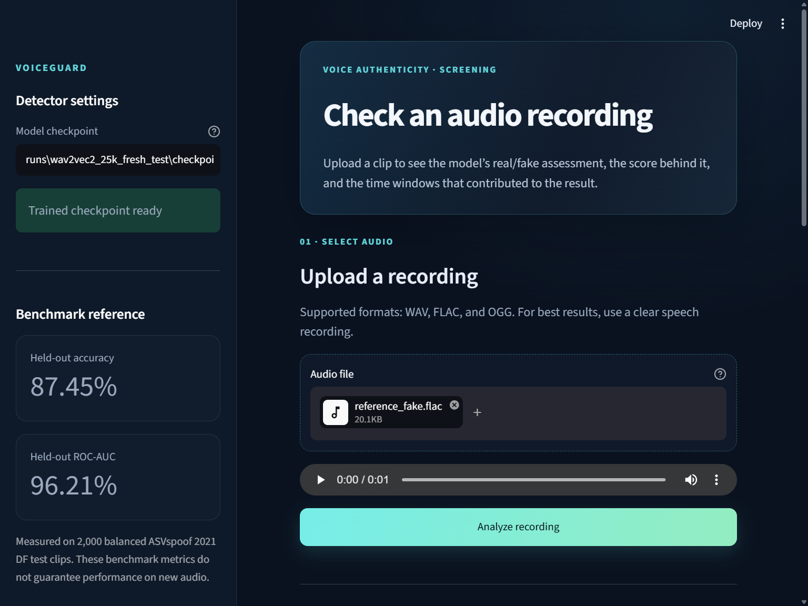

# VoiceGuard

**VoiceGuard is a local audio deepfake screening application.** It analyzes
uploaded speech, estimates whether it resembles real or synthetic audio, and
shows the score and time range for each analyzed audio window. It combines a
fine-tuned Wav2Vec2 classifier with a Streamlit interface and a command-line
detector.

> **Research result:** On a balanced, 2,000-clip ASVspoof 2021 DF held-out
> subset, the latest recorded run measured **87.45% accuracy**, **96.21%
> ROC-AUC**, **96.64% precision**, **77.60% fake recall**, and **86.08% F1**.
> This is a benchmark-specific result, not a guarantee of performance on new
> recordings or an assessment of forensic authenticity.

## Highlights

- Upload WAV, FLAC, or OGG speech and receive a `Real` or `Fake` screening
  result.
- Inspect the mean fake score, the validation-selected decision threshold,
  per-window scores, flagged time regions, and a concise explanation.
- Run locally through Streamlit or use the JSON-producing command-line
  interface.
- Fine-tune and evaluate on separate train, validation, and held-out test
  splits; preserve manifests, hashes, metrics, and training history.
- Includes a log-mel CNN implementation, while the latest reported benchmark
  run uses the Wav2Vec2 transfer-learning path.

## Latest benchmark run

The recorded run is in `runs/wav2vec2_25k_fresh_test/` (generated model and
run artifacts are not tracked in this repository).

| Split / metric | Result |
|---|---:|
| Training | 50,000 clips: 25,000 real + 25,000 fake |
| Validation | 4,000 clips: 2,000 real + 2,000 fake |
| Held-out test | 2,000 clips: 1,000 real + 1,000 fake |
| Accuracy | 87.45% |
| ROC-AUC | 96.21% |
| Precision | 96.64% |
| Fake recall | 77.60% |
| F1 | 86.08% |
| Confusion matrix (actual rows; predicted columns: Real, Fake) | `[[973, 27], [224, 776]]` |

The confusion matrix means 973 real clips were correctly classified and 27
were flagged as fake; 776 fake clips were correctly classified and 224 were
missed. The decision threshold was selected on validation data. The test
audio hashes do not overlap the earlier evaluated sample, but this evaluation
still uses the same official ASVspoof 2021 DF test partition and its
class-ordered source shards; it is not an independent external benchmark.

The model was fine-tuned for nine epochs on an NVIDIA GeForce RTX 5060 Laptop
GPU. The checkpoint with the best validation ROC-AUC was from epoch 6. The
reported test result did not reach 90% accuracy.

## System architecture

```text
WAV / FLAC / OGG
      │
      ▼
Decode → mono → resample to 16 kHz → overlapping audio windows
      │
      ├── Latest model: Wav2Vec2 encoder → masked mean/std pooling
      │                 → binary classification head
      │
      └── Alternate model: log-mel spectrogram → CNN classifier
      │
      ▼
Window scores → mean score + validation-selected threshold
      │
      ▼
Real/Fake screening result + time regions + explanation
```

For the reported Wav2Vec2 run, four top encoder layers and the classification
head were fine-tuned. Each audio window is padded or cropped to at most four
seconds; masked temporal mean and standard-deviation pooling produce the
classifier representation. Audio preprocessing and windowing are implemented
in `voiceguard/audio.py`; the transfer model is in `voiceguard/transfer.py`;
inference and result explanations are in `voiceguard/inference.py`.

## Technology

- Python 3.10
- PyTorch 2.11 with CUDA 12.8 for the recorded RTX 5060 run
- Hugging Face Transformers / Wav2Vec2
- NumPy, SciPy, SoundFile, and scikit-learn
- Streamlit
- pytest

## Quick start (Windows PowerShell)

Create and activate a virtual environment, install a CUDA-enabled PyTorch
build, then install the project dependencies:

```powershell
py -3.10 -m venv .venv
.\.venv\Scripts\Activate.ps1
python -m pip install --upgrade pip
python -m pip install torch --index-url https://download.pytorch.org/whl/cu128
python -m pip install -r requirements.txt
python -c "import torch; print(torch.cuda.is_available(), torch.cuda.get_device_name(0) if torch.cuda.is_available() else 'CUDA unavailable')"
```

If PowerShell blocks environment activation, run commands with
`.\.venv\Scripts\python.exe`.

### Launch the upload interface

The app's default checkpoint path is
`runs/wav2vec2_25k_fresh_test/checkpoint.pt`. Obtain the compatible trained
checkpoint as described under [Model and data](#model-and-data), then run:

```powershell
python -m streamlit run app.py
```

### Analyze audio from the command line

```powershell
python detect.py path\to\sample.wav `
  --model runs\wav2vec2_25k_fresh_test\checkpoint.pt `
  --output runs\wav2vec2_25k_fresh_test\detection.json
```

### Run the tests

```powershell
python -m pytest
```

The project test suite passed **19 tests** in the development environment.

## Model and data

The dataset downloader obtains a reproducible subset of the
[ASVspoof 2021 DF dataset mirror](https://huggingface.co/datasets/MoaazTalab/ASVspoof_2021_DF_Balanced_Normalized),
pinned to revision
`479fbf291c9da1fca8c6b20d68b84442b2699f6b`. The original
[ASVspoof 2021 challenge site](https://www.asvspoof.org/index2021.html)
describes the speech databases as available under the Open Data Commons
Attribution License (ODC-By). The mirror card does not independently state a
license. Check applicable terms and retain attribution before redistributing
dataset material or trained artifacts.

Download a sample dataset:

```powershell
python download_dataset.py --data-dir data `
  --train-per-class 5000 --val-per-class 1000 --test-per-class 1000
```

To reproduce the larger training selection and exclude hashes from the earlier
test sample:

```powershell
python download_dataset.py --data-dir data\wav2vec2_generalization `
  --source-dir data\_source `
  --train-per-class 25000 --val-per-class 2000 --test-per-class 1000 `
  --exclude-test-manifest data\acquisition_manifest.json --seed 42
```

Train the transfer-learning head and fine-tune the Wav2Vec2 model:

```powershell
python train_transfer.py --data-dir data `
  --output-dir runs\wav2vec2_asvspoof2019_transfer `
  --max-per-class 5000 --require-cuda

python fine_tune_transfer.py --data-dir data\wav2vec2_generalization `
  --source-run runs\wav2vec2_asvspoof2019_transfer `
  --output-dir runs\wav2vec2_25k_fresh_test `
  --max-per-class 25000 --epochs 10 --batch-size 8 --eval-batch-size 16 `
  --encoder-learning-rate 1e-5 --head-learning-rate 1e-4 `
  --unfrozen-layers 4 --patience 3 --seed 42 --require-cuda
```

The training scripts choose the checkpoint and threshold using validation
data; the held-out test split is reserved for final evaluation. The source
model is a pinned Wav2Vec2 checkpoint trained for ASVspoof 2019 LA detection.
Review its model card and applicable license before redistribution:
[model card](https://huggingface.co/caa-speech-detection-asvspoof2019/wav2vec2-v2-unfrozen).

## Evidence and outputs

A completed run writes the following under its run directory:

- `checkpoint.pt` — trained model and decision threshold.
- `training_history.csv` — epoch-level training loss and validation metrics.
- `evaluation.json` — held-out metrics, confusion matrix, and predictions.
- `run_manifest.json` — configuration, hardware, dataset provenance, and file
  hashes.
- `detection_fake.json` and `detection_real.json` — example windowed
  detections.
- `proof_training.png` and `proof_evaluation.png` — training and evaluation
  plots.
- `VoiceGuard_Evidence.zip` — generated evidence bundle.

Generate plots and detection examples with:

```powershell
python generate_evidence.py --run-dir runs\wav2vec2_25k_fresh_test `
  --data-dir data\wav2vec2_generalization
```

Project UI screenshots are in `proofs/`. A README image preview is shown
below.



## Repository contents

```text
app.py                  Streamlit upload and result interface
detect.py               Command-line audio detection
download_dataset.py     Dataset acquisition and provenance manifests
train_transfer.py       Transfer-learning head training
fine_tune_transfer.py   Wav2Vec2 fine-tuning and held-out evaluation
generate_evidence.py   Evidence plots, examples, and ZIP bundle
show_results.py         Printed training/evaluation summaries
voiceguard/             Audio, model, training, and inference modules
tests/                  Unit and component tests
proofs/                 Generated result and UI screenshots
```

## Limitations

VoiceGuard is a research prototype for screening, not an authentication
service. Model scores are not calibrated probabilities of authenticity.
Window scores identify regions the model scored highly; they do not prove
that a specific segment was generated or edited. Accuracy depends on dataset
composition and may change with speakers, codecs, recording conditions, and
generation methods. Do not rely on this model as the sole basis for legal,
forensic, or other high-stakes decisions.

Audio datasets, cached shards, trained checkpoints, and run directories are
kept out of Git by `.gitignore`. Their inclusion in this public repository
would be impractical due to size and may require separate redistribution
permissions.
